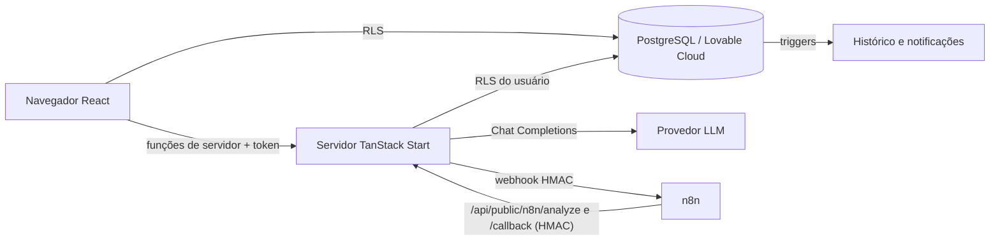

# FluxoIA — Central Inteligente de Solicitações

Projeto de portfólio (trilha AI Builder). Aplicação web que centraliza solicitações internas de pequenas equipes e usa três agentes de IA para sugerir categoria, prioridade, resumo e próxima ação — sempre com supervisão humana, rastreabilidade e métricas calculadas a partir dos dados.

## 1. Problema de negócio
Equipes de operações, suporte e administração recebem demandas por vários canais e precisam ler, classificar, priorizar, registrar, encaminhar e acompanhar cada uma manualmente. É lento, inconsistente e raramente medido.

## 2. Público-alvo
Pequenas equipes de operações, suporte, atendimento e administração.

## 3. Funcionalidades implementadas
- Cadastro, login, logout, recuperação de senha, perfil; cada usuário pertence a uma organização (criada no cadastro).
- CRUD de solicitações com busca, filtros combinados, ordenação, paginação, detalhes em abas (informações, análise da IA, histórico, automações) e exclusão com confirmação.
- Pipeline de IA com 3 etapas (classificador → resumidor → planejador), saída JSON validada por schema, timeout, nova tentativa, proteção contra duplicidade, limite por hora, registro de prompt/provedor/modelo, histórico de análises e feedback 👍/👎.
- Revisão humana: aprovar ou corrigir categoria/prioridade com registro do valor original, corrigido, revisor e horário.
- Integração n8n por webhooks HMAC, idempotente, com retentativas, auditoria e botão "Executar novamente".
- Notificações internas automáticas (trigger no banco) e webhook externo opcional.
- Dashboard com filtros (período, categoria, prioridade, status) e indicadores derivados.
- Impacto e produtividade: amostras de tempo manual/revisão, fórmulas documentadas, alerta de dados insuficientes, relatório exportável.
- Avaliação da IA com conjunto sintético (inclui ambiguidade e injeção de instruções).
- Exportação CSV dos registros filtrados (com proteção contra injeção de fórmulas).
- Modo demonstração explícito (`is_demo`), que pode ser carregado e reiniciado.

## 4. Arquitetura

Fluxo da automação: ver `docs/n8n-setup.md`. Orquestração dos agentes: ver página "Prompts dos agentes" e `src/lib/ai/pipeline.server.ts`. Os três agentes usam o mesmo modelo com prompts distintos; não são agentes autônomos.

## 5. Tecnologias
React 19 + TypeScript, TanStack Start (SSR e funções de servidor — substituem Edge Functions neste stack), Vite, Tailwind CSS v4, shadcn/ui, Lucide, Recharts, React Hook Form + Zod, Lovable Cloud (PostgreSQL, Auth, RLS), Lovable AI Gateway (ou outro provedor compatível) e n8n.

## 6. Modelo de dados
`docs/data-model.md`.

## 7. Banco e autenticação
O backend é provisionado pelo Lovable Cloud. Migrations em `drizzle/migrations/`. Dados fictícios: botão "Carregar demonstração" (função `seed_demo_data()`), removíveis com "Reiniciar demonstração".

## 8. Provedor de IA
Padrão: Lovable AI Gateway (`LOVABLE_API_KEY`, gerenciado), modelo `google/gemini-3-flash-preview`. Para outro provedor compatível: `LLM_BASE_URL`, `LLM_API_KEY`, `LLM_MODEL`. As chaves só existem no servidor. Sem chave, a interface informa que a análise está indisponível — nunca simula respostas.

## 9. n8n
`docs/n8n-setup.md` e `docs/n8n-workflow.json`. Endpoints em `docs/api.md`.

## 10. Variáveis de ambiente
`.env.example`.

## 11. Execução local
```sh
npm i
npm run dev
```

## 12. Testes
```sh
npm test
```
`src/test/business-rules.test.ts` cobre: regra de revisão humana, validação de schema, fórmulas de impacto, acurácia, CSV seguro e assinatura HMAC.

## 13. Avaliação da IA e produtividade
`docs/evaluation.md`.

## 14. Limitações conhecidas
- Conjunto de avaliação pequeno e sintético.
- A confiança é autoavaliação do modelo, não probabilidade calibrada.
- Prompts são versionados no código; não há edição pela interface.
- Um usuário pertence a uma organização; convites para equipe não foram implementados.
- Dashboard lê até 1000 registros por tabela no navegador.

## 15. Dependências externas ainda não configuradas
- **n8n**: requer instância real + `N8N_WEBHOOK_URL`/`N8N_WEBHOOK_SECRET`. Não testado contra instância real.
- **Notificação externa (e-mail/webhook)**: requer `NOTIFY_WEBHOOK_URL` (ou nó de e-mail no n8n). Nenhum e-mail é enviado pelo app.
