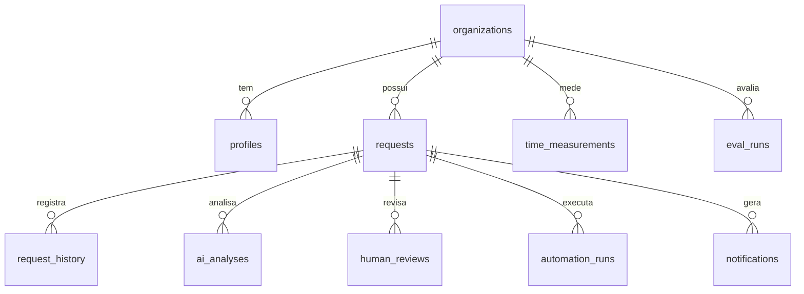

# Modelo de dados

Migrations: `drizzle/migrations/0000_fluxoia_schema.sql`, `0001_seed_definer.sql`.

| Tabela | Finalidade | Escrita pelo usuário |
|---|---|---|
| `organizations` | Equipe (criada no cadastro) | atualizar nome |
| `profiles` | Usuário ↔ organização | próprio perfil (não pode trocar de organização) |
| `requests` | Solicitações + campos da IA + estado da automação | CRUD na própria organização |
| `request_history` | Auditoria de alterações (trigger) | somente leitura |
| `ai_analyses` | Cada execução do pipeline: prompt, provedor, modelo, etapas, saída, erro, duração, feedback | via servidor |
| `human_reviews` | Aprovação/correção: valor original, corrigido, revisor, horário | inserir como si mesmo |
| `automation_runs` | Execuções n8n (`execution_id` único) | somente leitura (servidor escreve) |
| `notifications` | Notificações internas (trigger) | marcar lida / excluir |
| `time_measurements` | Amostras de tempo manual e de revisão | CRUD |
| `eval_runs` | Resultados da avaliação sintética | via servidor |

Versões de prompt são versionadas no código (`src/lib/ai/prompts.ts`) e gravadas em `ai_analyses.prompt_version` e `eval_runs.prompt_version`.

## Segurança
- RLS em todas as tabelas; todas as políticas usam `organization_id = current_org_id()`, uma função `SECURITY DEFINER` que lê a organização do perfil do usuário.
- `WITH CHECK` nas políticas de UPDATE impede mover registros para outra organização.
- `automation_runs` só é gravada pelo servidor (cliente admin, após verificação de assinatura ou de acesso via RLS).
- Dados de demonstração têm `is_demo = true`; `seed_demo_data()` e `reset_demo_data()` atuam somente na organização do usuário.
