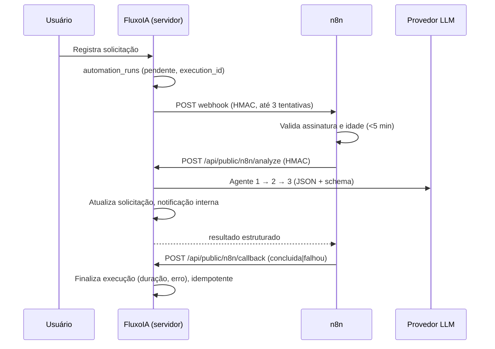

# Configuração do n8n

> Status: o contrato e o workflow importável estão implementados, mas **nenhuma instância real do n8n foi conectada ou testada** neste projeto. Siga os passos abaixo e confirme com uma execução real.

## 1. Pré-requisitos
- Instância n8n (self-hosted ou cloud) acessível pela internet.
- URL pública do FluxoIA (preview ou publicada).
- Um segredo compartilhado forte (ex.: 64 caracteres aleatórios).
- Em n8n self-hosted, permita `require('crypto')` no nó Code: `NODE_FUNCTION_ALLOW_BUILTIN=crypto`.

## 2. Variáveis no n8n
| Variável | Valor |
|---|---|
| `FLUXOIA_BASE_URL` | URL do app, sem barra final (ex.: `https://<seu-app>.lovable.app`) |
| `FLUXOIA_WEBHOOK_SECRET` | o mesmo segredo configurado no FluxoIA |

## 3. Importar o workflow
1. n8n → *Workflows* → *Import from file* → `docs/n8n-workflow.json`.
2. Abra o nó **Webhook FluxoIA** e copie a *Production URL*.
3. Ative (publique) o workflow.

## 4. Variáveis no FluxoIA (segredos do servidor)
| Segredo | Valor |
|---|---|
| `N8N_WEBHOOK_URL` | Production URL copiada no passo 3 |
| `N8N_WEBHOOK_SECRET` | o segredo compartilhado |

Sem essas duas variáveis, o app analisa novas solicitações diretamente pelo backend e mostra "n8n não configurado".

## 5. Fluxo

## 6. Teste
1. Cadastre uma solicitação no app.
2. Na aba **Automações** da solicitação, a execução deve passar por *Pendente → Executando → Concluída*.
3. Em caso de falha, o botão **Executar novamente** cria uma nova tentativa (novo `execution_id`, mesma solicitação).

## 7. Notificação ao responsável
Adicione, entre "Preparar callback" e "Registrar resultado", um nó de e-mail/Slack do próprio n8n e altere `notification_sent` para `true` quando o envio ocorrer. O FluxoIA apenas registra o que o n8n informar.
